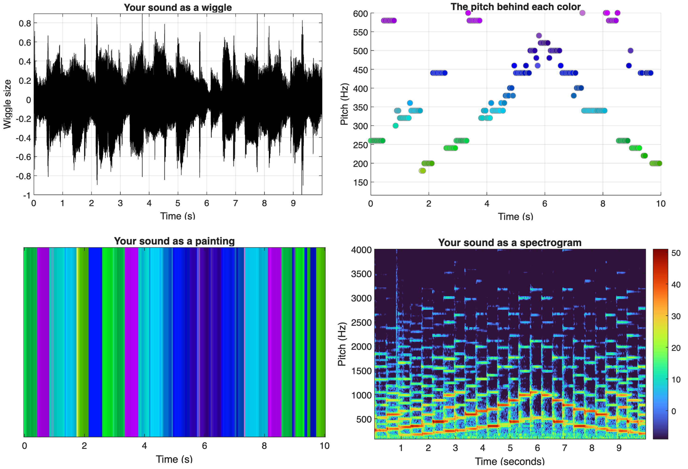

# Color Beats Challenge
## Record sounds, analyze audio waves, and create colorful images from sound data with MATLAB

This repository includes the student activity files and an instructor guide for the MATLAB&reg; activity accompanying the [TryEngineering Color Beats Challenge](https://tryengineering.org/explore-resources/collections/engineering-simulations/#:~:text=Workshop%20Replay!-,Color,-Beats%20Challenge) and is an optional extension of the [TryEngineering Bright Beats Challenge](https://tryengineering.org/resource/lesson-plan/bright-beats-challenge/).

In this activity, you'll be recording sounds to turn them into pictures! In the Bright Beats Challenge, you used a micro:bit&trade; to create a digital synthesizer that could transform ambient light levels and simple images into musical notes and MATLAB to turn digital images into piano notes. In the Color Beats Challenge, you'll reverse this process and instead turn sounds into pictures! Through the process, students will learn that sound travels as waves. The characteristics of sound waves (pitch, loudness, and purity) can be represented by different colors and turned into an image. When a microphone records audio, the sound turns into a list of numbers. MATLAB can measure that list and transform those numbers into colors. 

## Set-up
**Required MathWorks&reg; Products (https://www.mathworks.com)**

This was created with MATLAB release R2026a
- [MATLAB](https://www.mathworks.com/products/matlab.html)

**Other Materials**
- A device with a microphone (either a computer with an attached or built-in microphone or a mobile device running [MATLAB&reg; Mobile&trade;](https://www.mathworks.com/products/matlab-mobile.html))

## Instructions

1. (_Optional_) Complete the [TryEngineering Bright Beats Design Challenge](https://tryengineering.org/resource/lesson-plan/bright-beats-engineering-lesson/). 
2. (_Optional_) Open the Activity Guide PDF file.
3. Open this repository in MATLAB&reg; Online&trade;, or clone and download this repository to your local machine and open in MATLAB Desktop.
4. Open the [ColorBeatsChallenge_Student_Activity.mlx](ColorBeatsChallenge_Student_Activity.mlx) Live Script to follow the step by step instructions.

## License

The [license](LICENSE) is available in this GitHub&reg; repository.

## Community Support

[MATLAB Central](https://www.mathworks.com/matlabcentral/)

Copyright 2026 The MathWorks, Inc.

