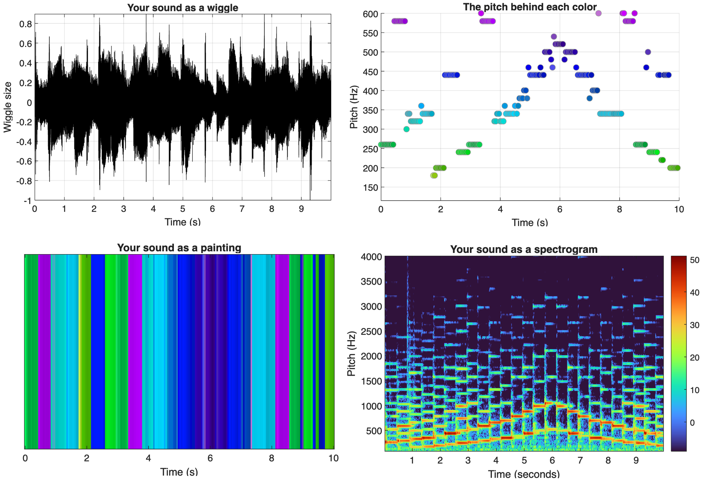

# Color Beats Challenge
## Record sounds, analyze audio waves, and create colorful images from sound data with MATLAB

This repository includes the student activity files and an instructor guide for the MATLAB&reg; activity accompanying the [TryEngineering Color Beats Challenge](https://tryengineering.org/explore-resources/collections/engineering-simulations/#:~:text=Workshop%20Replay!-,Color,-Beats%20Challenge) and is an optional extension of the [TryEngineering Bright Beats Challenge](https://tryengineering.org/resource/lesson-plan/bright-beats-challenge/).

In this activity, you'll be recording sounds to turn them into pictures! In the Bright Beats Challenge, you used a micro:bit&trade; to create a digital synthesizer that could transform ambient light levels and simple images into musical notes and MATLAB to turn digital images into piano notes. In the Color Beats Challenge, you'll reverse this process and instead turn sounds into pictures! Through the process, students will learn that sound travels as waves. The characteristics of sound waves (pitch, loudness, and purity) can be represented by different colors and turned into an image. When a microphone records audio, the sound turns into a list of numbers. MATLAB can measure that list and transform those numbers into colors. 



## Set-up
**Required MathWorks&reg; Products (https://www.mathworks.com)**

This was created with MATLAB release R2026a
- [MATLAB](https://www.mathworks.com/products/matlab.html)

**Other Materials**
- **Optional:** A device with a microphone (either a computer with an attached or built-in microphone or a mobile device running [MATLAB&reg; Mobile&trade;](https://www.mathworks.com/products/matlab-mobile.html)). The included piano
  sample lets you complete the activity if you don't have a device with a microphone.

## Instructions

1. Click **Open in MATLAB Online** below and sign in to your MathWorks account. If you have MATLAB installed on your computer, clone and download this repository to your local machine and open the folder in MATLAB Desktop.

   [](https://matlab.mathworks.com/open/github/v1?repo=MathWorks-Teaching-Resources/color-beats-challenge)

2. Wait for the files to open. In MATLAB's **Files** panel, you should see both the `README.md`
   file and the `toolbox` folder. If you only see a folder named
   `color-beats-challenge`, double-click it first.
3. Click the **Command Window**: the area where MATLAB displays the `>>`
   prompt. Copy this line, paste it after the prompt, and press Enter:

   ```matlab
   mpminstall("toolbox")
   ```

4. If MATLAB asks whether to continue, type `Yes` and press Enter. This sets
   up the files so MATLAB can find them. You only need to do this once for
   this version of the activity.
5. In the same Command Window, enter:

   ```matlab
   openColorBeatsChallenge
   ```

6. The activity opens with instructions and controls. Next time, start MATLAB and enter `openColorBeatsChallenge` without downloading the files again.


## Try the piano sample

1. In **Get Started**, leave **Audio source** set to **Sample audio**.
   Press **Choose audio source**.
2. In **Part 1**, press **Build the rainbow!** to make your color key.
3. In **Part 2**, press **Load or record my sound!** MATLAB loads the included
   piano scales and shows their sound waves. No microphone is used.
4. Continue through **Parts 3 to 5**. Follow the instructions, change the
   sliders, and press each section's button to update the pictures.

The notes go up a C-major scale from C3 to C5, then come back down. Can you
predict how the colors will change? The sample was made in MATLAB and sounds
like a piano; it is not a recording of an acoustic piano.

## Try your own voice

1. Return to **Get Started** in the activity.
2. Change **Audio source** to **Computer** and press **Choose audio source**.
3. Choose your microphone. Allow microphone access if your computer or
   browser asks.
4. In **Part 2**, choose how many seconds to record and press
   **Load or record my sound!** After the countdown, speak, sing, whistle, or hum.
5. Run the remaining parts again to turn your recording into colors.

To use a phone or tablet as your microphone, choose **Mobile device** and
follow the MATLAB Mobile setup instructions inside the activity.

### Optional: explore the app

On MATLAB Desktop or MATLAB Online in a computer browser, enter
`ColorBeatsApp` in the Command Window. Choose **Demo Sound** for the same piano
scales or **Record** to use a microphone. The app is optional; the student
activity contains the full lesson. The app window does not work in MATLAB Mobile.

## For teachers

Use the [Color Beats Challenge Activity Guide](<toolbox/doc/Color Beats Challenge Activity Guide.pdf>)
for teaching ideas.

This activity accompanies the
[TryEngineering Color Beats Challenge](https://tryengineering.org/explore-resources/collections/engineering-simulations/#:~:text=Workshop%20Replay!-,Color,-Beats%20Challenge)
and can follow the
[TryEngineering Bright Beats Challenge](https://tryengineering.org/resource/lesson-plan/bright-beats-challenge/).
Bright Beats is optional. Students can start Color Beats directly.

## Need help?

- **Can't find the Command Window?** Look for the panel with the `>>` prompt.
  If hidden, use MATLAB's **Layout** menu to show the Command Window.
- **MATLAB can't find `toolbox`?** Open the extracted activity folder in MATLAB
  first. `README.md` and `toolbox` should appear together in the Files panel.
  Then try `mpminstall("toolbox")` again.
- **The activity is already installed?** Skip installation and enter
  `openColorBeatsChallenge`.
- **MATLAB can't find `openColorBeatsChallenge`?** Complete the installation
  steps above. Type the command exactly as shown, including capital letters.
- **The activity opens as code rather than a lesson?** Right-click the activity
  file in MATLAB's Files panel and choose **Open as Live Script**. If that option
  is unavailable, check your MATLAB version.
- **No microphone, or recording doesn't work?** Choose **Sample audio** and
  press **Choose audio source**. You can still complete the activity.

For more MATLAB help, visit [MATLAB Central](https://www.mathworks.com/matlabcentral/).


## License

The [license](LICENSE) is available in this GitHub&reg; repository.

Copyright 2026 The MathWorks, Inc.
